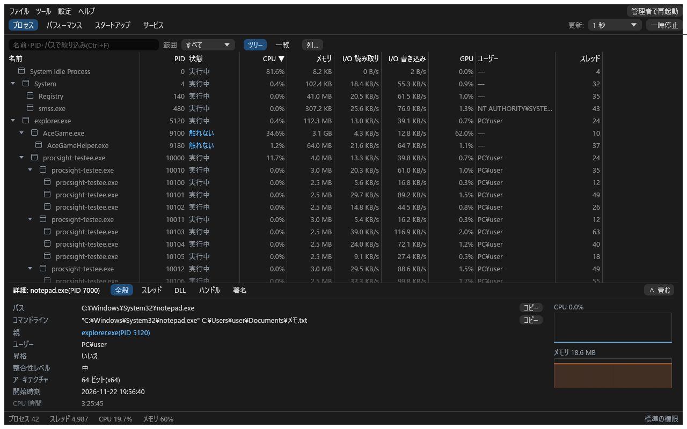
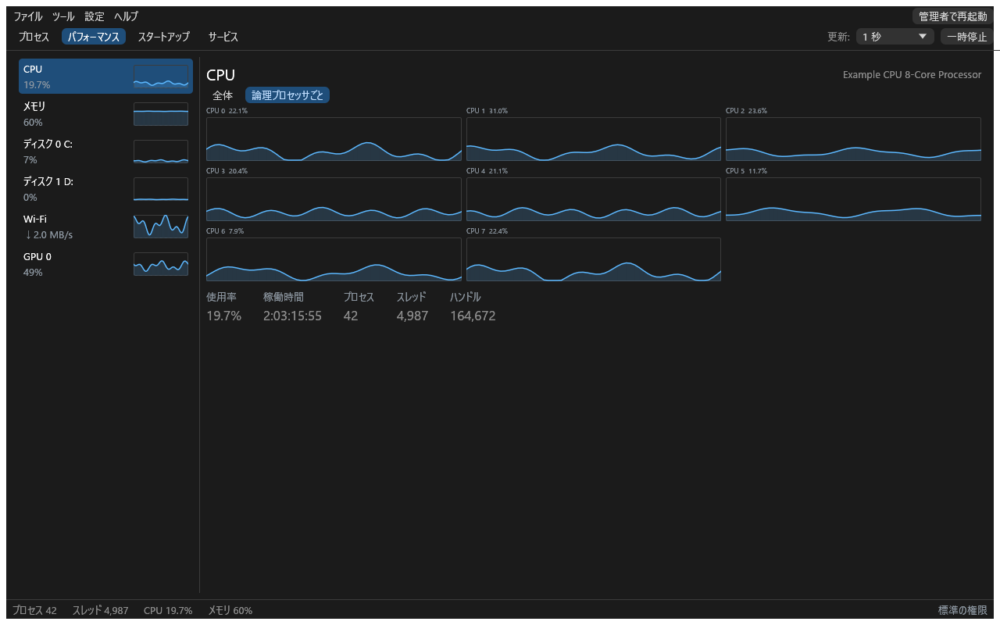

# ProcSight

English | [日本語](README_ja.md)

A process manager for Windows 11 that replaces the built-in Task Manager. It is a single exe written in Rust and egui, needs no installer, and has a Japanese user interface.



## Features

- **Processes**: tree and flat views, sorting, filtering by name, PID or path, configurable columns (shown, order, width; remembered), highlighting of started and exited rows
- **Actions**: end process, end process tree, end several at once, priority (Idle to High), CPU affinity, efficiency mode, suspend and resume, bring to front, open file location, properties
- **Details**: general (path, command line, parent, user, elevation, integrity level, architecture), threads, DLLs, handles, signature (verified without network access), small CPU and memory graphs
- **Find what locks a file**: drop a file that "is in use" to see which processes hold it
- **Performance**: CPU (total and per logical processor), memory, disks, network adapters and GPUs (last 60 samples)
- **Startup**: enable or disable registry Run entries and startup folder items, recorded the same way Task Manager does, so both tools show the same state
- **Services**: start, stop, restart and change the start type; running dependent services are listed before stopping
- **Replace Task Manager** (off by default): open ProcSight with Ctrl+Shift+Esc and from the Ctrl+Alt+Del screen
- Dark and light themes, font size, optional tray icon with CPU usage, keyboard shortcuts (Delete, Ctrl+F, Ctrl+1 to Ctrl+4, Ctrl+C)



## What ProcSight does not do

- **No network access at all**: no update checks, telemetry, online lookups or certificate revocation checks.
- **No history**: graphs keep only the last 60 samples in memory.
- **Critical processes cannot be ended or suspended**: Windows core processes (System, csrss.exe, lsass.exe and others), processes marked critical, and ProcSight itself.
- No realtime priority, dumps, closing other processes' handles, or reading and writing other processes' memory.

## Touch-free processes (for gamers)

Register exe names (for example `game.exe`) under Settings → Touch-free processes. ProcSight never opens a handle to those processes or their descendants. They still appear in the list, but details and actions are not available. This is meant to avoid upsetting anti-cheat software.

- **Processes that are not registered are opened once when they are first seen** (with query-only rights, closed right away) to read their path and user. Register your games before starting ProcSight or before starting the game.
- The process list is read only with `NtQuerySystemInformation`, which opens no process handles.
- Every call that opens a process goes through a single gate that refuses touch-free processes. The number of opens per PID is shown under Settings → Diagnostics.
- **This is not a guarantee of safety with any anti-cheat.** If in doubt, close ProcSight while playing.

## Requirements

- Windows 11 (x64). Windows 10 is not supported.
- Runs without administrator rights. To manage other users' processes, services or all-users startup items, use "Restart as administrator" at the top of the window.

## Usage

1. A prebuilt zip will be published on [Releases](https://github.com/takosasi-dev/procsight/releases) after hands-on verification (not yet available). Until then, build it as described in "Building from source".
2. Put `ProcSight.exe` in any folder and run it.

Settings are stored in `%APPDATA%\ProcSight\config.toml` and logs in `%LOCALAPPDATA%\ProcSight\logs\` (7 days). Logs never contain command lines, full paths or user names.

### Opening ProcSight with Ctrl+Shift+Esc

This uses Image File Execution Options (the `Debugger` value of `taskmgr.exe`), the same mechanism as Process Explorer's "Replace Task Manager".

1. Put `ProcSight.exe` in `C:\Program Files\ProcSight\`. The option is only available from a location standard users cannot modify.
2. Run ProcSight as administrator and turn on the option in Settings → General.
3. The real Task Manager can still be opened from the context menu of a touch-free process ("Open Windows Task Manager").

**To undo** (three ways, so you can recover even if ProcSight no longer starts):

- Turn the option off in Settings
- Double-click `restore-taskmgr.reg` from the zip
- Run this in an elevated command prompt:

```
reg delete "HKLM\SOFTWARE\Microsoft\Windows NT\CurrentVersion\Image File Execution Options\taskmgr.exe" /v Debugger /f
```

Because malware also uses this registry location, security software may remove the value. ProcSight tells you at startup when that happens.

## Building from source

Requires Rust 1.95 or later and Visual Studio's "Desktop development with C++" workload (MSVC and the Windows SDK).

```
cargo build --release -p procsight-app
```

This produces `target\release\ProcSight.exe`. `tools\publish.ps1` builds the distribution zip.

### Checks

```
cargo test --workspace
cargo clippy --workspace --all-targets -- -D warnings
cargo deny check licenses bans
```

UI tests render without creating a window (egui_kittest). `procsight-testee` is a test process and is not distributed. `procsight-probe` cross-checks undocumented NT structures against public APIs.

## Layout

| crate | Role |
|---|---|
| `procsight-core` | Platform-independent logic (diffs, tree, filters, safety rules, config). Uses no Windows crates |
| `procsight-win` | Win32 and NT API calls. The only crate with `unsafe` |
| `procsight-app` | User interface (eframe / egui) |
| `procsight-probe` / `procsight-uiprobe` / `procsight-testee` | Verification tools |

## Status

v0.1.0 is in preparation and has not been released yet. The automated tests (about 130) and checks with standard user rights pass. Administrator operations (services, all-users startup items, replacing Task Manager) and comparisons with Task Manager's numbers are still waiting for hands-on verification.

## License

MIT License ([LICENSE](LICENSE)). Licenses of the bundled crates are listed in [THIRD-PARTY-NOTICES.md](THIRD-PARTY-NOTICES.md). Japanese text is drawn with fonts that ship with Windows (such as Yu Gothic UI); no fonts are bundled.
