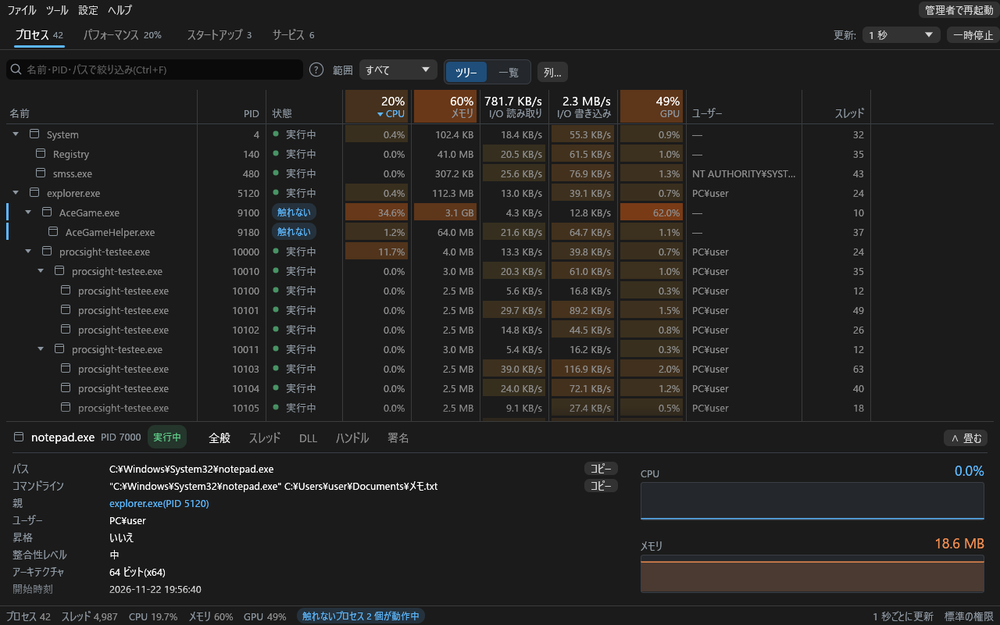
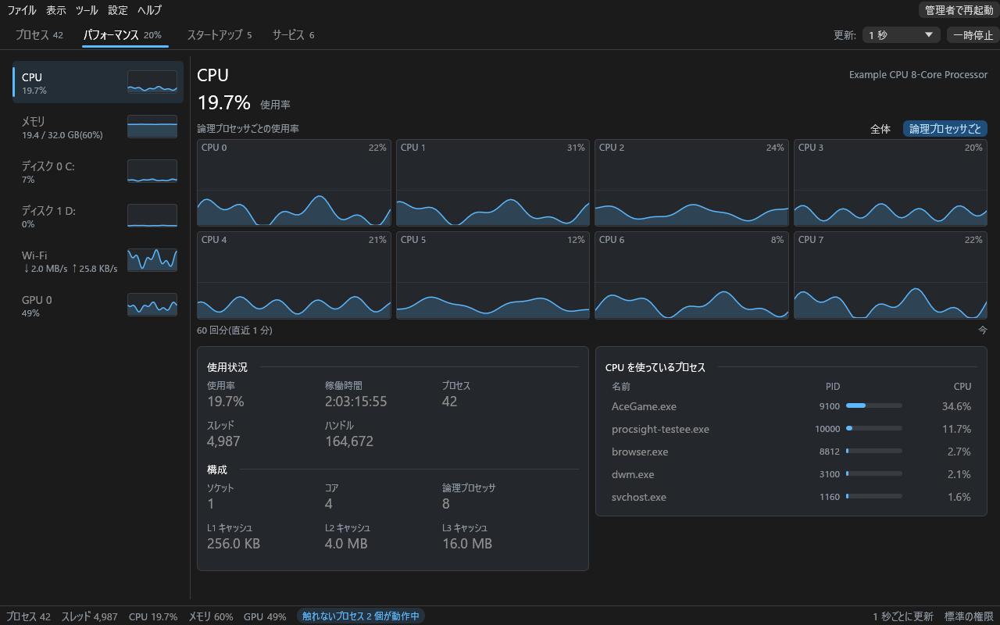
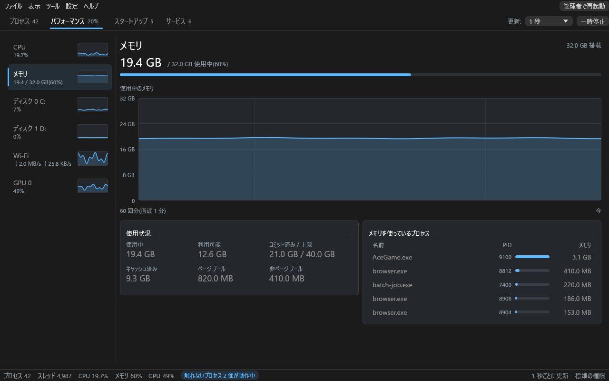
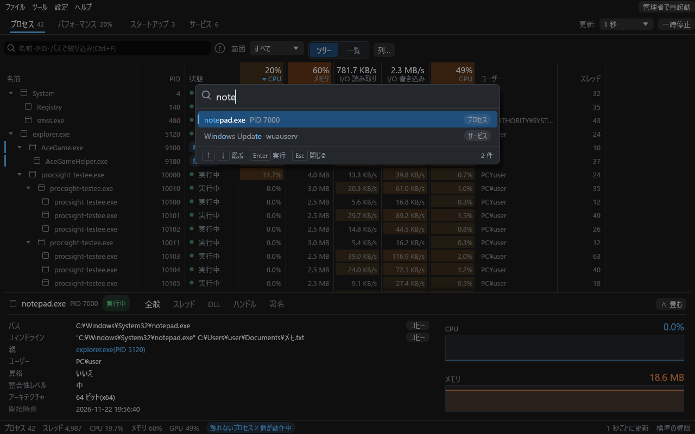
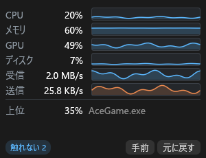
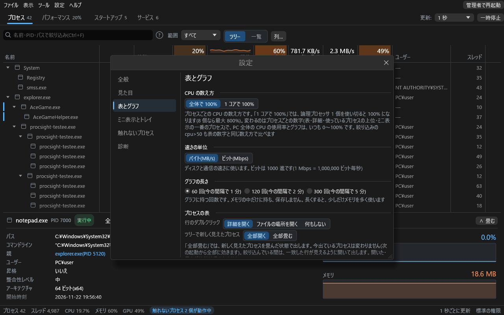

# ProcSight

[English](README.md) | 日本語

Windows 11 の標準のタスク マネージャーの代わりに使う、日本語のプロセス管理ソフトです。Rust と egui で作った 1 つの exe で、インストールは要りません。



## できること

- **プロセス**: ツリーと一覧、並べ替え、名前・PID・パスでの絞り込み、列の表示・順序・幅の変更(次の起動にも残る)、新しく始まった行と終わった行の色分け
  - CPU・メモリ・I/O・GPU のセルを使っている量で塗り、列の見出しに全体の値を出す(設定で切れる)
  - 絞り込みの書き方: `cpu>5`、`mem>1gb`、`gpu>10`、`io>1mb`、`pid:1234`、`user:system`、`state:応答なし` などを空白で並べて重ねられる
  - System Idle Process は、どの列で並べても一番下に置く
  - 行の高さ(詰める・標準・ゆったり)
  - 「CPU の推移」の列: プロセスごとの直近の小さなグラフ
  - 一覧を CSV で保存(Excel で開ける形。式に見える値は無害にする)
- **操作**: 終了、ツリーごとの終了、複数まとめての終了、優先度(低〜高)、CPU の割り当て、効率モード、一時停止と再開、前面に出す、ファイルの場所を開く、プロパティ
- **詳細**: 全般(パス・コマンドライン・親・ユーザー・昇格・整合性レベル・アーキテクチャ)、スレッド、DLL、ハンドル、署名(ネットにつながずに確かめる)、CPU とメモリの小さなグラフ
- **ファイルを掴んでいるプロセスを探す**: 「使用中で消せない」ファイルをドロップすると、使っているプロセスが分かる
- **パフォーマンス**: CPU(全体と論理プロセッサごと)、メモリ、ディスク、ネットワーク、GPU のグラフ(直近 60・120・300 回分から選ぶ)
  - CPU の構成(ソケット・コア・論理プロセッサ・L1〜L3 キャッシュ)、メモリの内訳(キャッシュ済み・ページ プール・非ページ プール)
  - そのリソースを使っているプロセスの上位 5 個。押すとプロセスのタブのその行へ移る
- **ミニ表示**(Ctrl+M): CPU・メモリ・GPU・ディスク・ネットだけの小さな窓。「常に手前に表示」と合わせると、ゲームの横や別の画面に置ける
- **ゲーム中は更新を遅く**(設定でオン。既定はオフ): 触れないプロセスが動いている間、ProcSight 自身の更新を遅くして軽くする
- **コマンド パレット**(Ctrl+K): タブ・操作・プロセス・サービスを名前の一部で探して移る。**キーボードのショートカットの一覧**は F1
- **スタートアップ**: レジストリの Run とスタートアップ フォルダの項目を有効・無効にする(Windows のタスク マネージャーと同じ記録の仕方なので、どちらで切り替えても同じ状態が出る)。タスク スケジューラのログオン時・起動時のタスク(有効・無効)と、ストア アプリのスタートアップ(見るだけ)も並べる
- **サービス**: 開始・停止・再起動・開始の種類の変更。止める前に、動いている依存のサービスを一覧で確かめる
- **Ctrl+Shift+Esc の置き換え**(設定でオン。既定はオフ): Ctrl+Shift+Esc と Ctrl+Alt+Del の「タスク マネージャー」で ProcSight が開く
- ダークとライトのテーマ、強調の色 6 つ、文字の大きさ、トレイのアイコン(設定でオン。CPU・メモリ・両方)、キーボードの操作(Delete・Ctrl+F・Ctrl+1〜4・Ctrl+C・Ctrl+K・Ctrl+M・F1)
- **設定**(既定はどれも今までと同じ): 起動時に開くタブ(前回のタブも選べる)、ミニ表示やトレイにしまった状態で起動、ミニ表示に出す物、プロセスの CPU を 1 コア 100% で数える、グラフの長さ、速さをビット(Mbps)で出す、行のダブルクリックの動き、ツリーを畳んで始める、使用量の塗りを始める所と一番濃くする所












## ProcSight がしないこと

- **ネットにつながりません。** 更新の確認・テレメトリ・オンラインの検索・署名の失効の確認を含め、通信は一切しません。
- **履歴を保存しません。** グラフの値と、プロセスごとの「CPU の推移」は、メモリの直近 60 回分(設定で 120・300 回分)だけです(終わったプロセスの分はすぐ消します)。
- **大事なプロセスは止めません。** System・csrss.exe・lsass.exe などの Windows の中核のプロセス、重要プロセスの印があるプロセス、ProcSight 自身は、終了も一時停止もできないようにしてあります。
- 優先度「リアルタイム」、ダンプの作成、他のプロセスのハンドルを閉じる・メモリを読み書きする機能はありません。

## タスク マネージャーとの軽さの比べ

2026-11-23 に 1 台の PC(Core i7-11700F、論理プロセッサ 16 個、メモリ 32 GB、Windows 11 ビルド 26220)で測りました。既定の設定の ProcSight v0.3.0 と Windows のタスク マネージャーを、どちらもプロセスのタブ・1 秒ごとの更新にして、なじませてから 2 秒ごとに 45 秒間を 2 回ずつ測りました。表は 2 回の幅です。

| | ProcSight v0.3.0 | タスク マネージャー |
|---|---|---|
| CPU(PC 全体に対して) | 0.13〜0.18% | 1.1〜1.6% |
| CPU(1 論理プロセッサを 100% として) | 2.1〜2.9% | 17.7〜25.2% |
| 使っているメモリ(ワーキング セット) | 186 MB | 222〜225 MB |
| 自分用に確保したメモリ(プライベート) | 388 MB | 160〜162 MB |
| スレッド / ハンドル | 32 / 830 | 33〜34 / 1,160 |
| 窓が出るまで | 43〜136 ミリ秒 | 測れず |

- CPU は ProcSight が約 6〜12 分の 1、使っているメモリも少し少なめでした。
- 自分用に確保したメモリは ProcSight の方が多く(約 2.4 倍)、GPU での描画と日本語のフォントの分と見ています(まだ調べていません)。
- 条件はそろっていません。タスク マネージャーは自分で管理者に上がり、後ろの窓のまま。ProcSight は管理者でなく、手前の窓(常に手前)でした。タスク マネージャーは 1 つしか開けないので、窓が出るまでの時間は測れませんでした。
- v0.4.0 は設定を足しただけで、既定の設定なら v0.3.0 と同じ仕事をします。

## 触れないプロセス(ゲームを遊ぶ人へ)

設定の「触れないプロセス」に exe 名(例: `game.exe`)を登録すると、そのプロセスと子孫には ProcSight からハンドルを開きません。一覧には出ますが、詳細の取得と操作は行いません。ゲームのアンチチートに怪しまれないようにするための設定です。


- **登録していないプロセスは、パスやユーザーを読むために、見つけたときに 1 回ずつ開きます**(読むだけの権限で開いて、すぐ閉じます)。ゲームは、ProcSight を起動する前、またはゲームを起動する前に登録してください。
- 一覧の取得は、どのプロセスのハンドルも開かない方法(`NtQuerySystemInformation`)だけで行います。
- ハンドルを開く処理は 1 か所の関門を通り、触れないプロセスはそこで必ず断ります。開いた回数は設定の「診断」で見られます。
- **これでアンチチートに対して安全だと保証するものではありません。** 心配なときは、ゲームの間は ProcSight を閉じてください。

## 動作環境

- Windows 11(x64)。Windows 10 は対象にしていません。
- 管理者でなくても起動できます。他のユーザーのプロセス・サービス・全ユーザーのスタートアップを変えるときは、画面上部の「管理者で再起動」を使います。

## 使い方

1. [Releases](https://github.com/takosasi-dev/procsight/releases) から `procsight-v<版>-windows-x64.zip` を取り、好きなフォルダに展開します(今の版はプレリリースです。下の「開発の状況」を見てください)。
2. `ProcSight.exe` を起動します。

設定は `%APPDATA%\ProcSight\config.toml`、ログは `%LOCALAPPDATA%\ProcSight\logs\`(7 日分)に置きます。ログにコマンドライン・フルパス・ユーザー名は書きません。

### Ctrl+Shift+Esc で ProcSight を開く

Windows の Image File Execution Options(`taskmgr.exe` の `Debugger` の値)を使います。Process Explorer の「Replace Task Manager」と同じ仕組みです。

1. `ProcSight.exe` を `C:\Program Files\ProcSight\` に置きます(標準のユーザーが書き換えられない場所に置いたときだけオンにできます)。
2. ProcSight を管理者で起動し、設定の「全般」で「Ctrl+Shift+Esc で ProcSight を開く」をオンにします。
3. 本物のタスク マネージャーは、プロセスの右クリックの「Windows のタスク マネージャーを開く」(触れないプロセスの行)から開けます。

**元に戻す方法**(ProcSight が起動できなくなったときも戻せるように 3 つ用意しています):

- 設定の画面でオフにする
- 配布物の `restore-taskmgr.reg` をダブルクリックして取り込む
- 管理者のコマンド プロンプトで次を打つ

```
reg delete "HKLM\SOFTWARE\Microsoft\Windows NT\CurrentVersion\Image File Execution Options\taskmgr.exe" /v Debugger /f
```

この場所はマルウェアにも使われるため、セキュリティ ソフトが値を消すことがあります。消されたときは、ProcSight が起動時に知らせます。

## ソースからビルドする

Rust 1.95 以上と、Visual Studio の「C++ によるデスクトップ開発」(MSVC と Windows SDK)が要ります。

```
cargo build --release -p procsight-app
```

`target\release\ProcSight.exe` ができます。配布用の zip は `tools\publish.ps1` で作ります。

### 確かめ

```
cargo test --workspace
cargo clippy --workspace --all-targets -- -D warnings
cargo deny check licenses bans
```

画面のテストは窓を作らずに描きます(egui_kittest)。`procsight-testee` はテスト用のプロセスで、配布物には入れません。`procsight-probe` は、公開されていない API の値を公開 API と突き合わせる確かめ用の道具です。

## 構成

| crate | 役割 |
|---|---|
| `procsight-core` | Windows に依存しない判定(差分・ツリー・絞り込み・止めてよいかの判定・設定)。Windows の crate を使わない |
| `procsight-win` | Win32 と NT の API の呼び出し。`unsafe` はこの crate だけ |
| `procsight-app` | 画面(eframe / egui) |
| `procsight-probe` / `procsight-uiprobe` / `procsight-testee` | 確かめ用の道具 |

## 開発の状況

v0.4.0 はプレリリースです。自動のテスト(245 件ほど)と、標準の権限での確かめは済んでいます。画面の動きは窓を作らないテストで確かめていて、新しい設定の実際の窓での手触りはまだ確かめていません。タスク マネージャーとの軽さの比べは上に載せています。管理者での操作(サービス・全ユーザーのスタートアップ・Ctrl+Shift+Esc の置き換え)と、タスク マネージャーとの値の比べは、作者の PC での確かめを待っています。

## ライセンス

MIT License([LICENSE](LICENSE))。依存する crate のライセンスは [THIRD-PARTY-NOTICES.md](THIRD-PARTY-NOTICES.md) にあります。日本語の文字は Windows に入っているフォント(Yu Gothic UI など)を使い、フォントは同梱していません。
